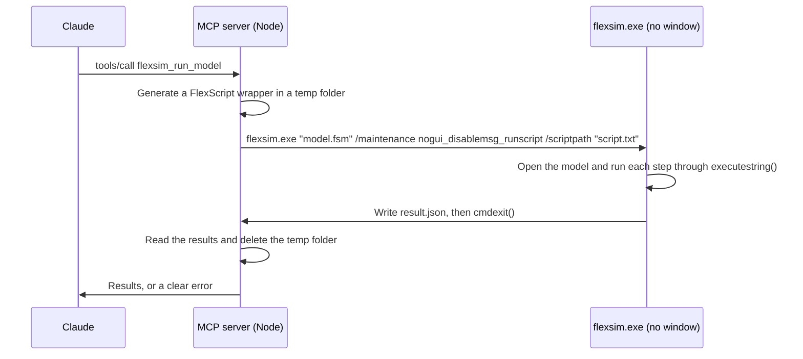

# Architecture

## How a run works

- `src/index.ts` defines the MCP tools and shapes results for the model.
- `src/flexsim.ts` finds FlexSim, generates the wrapper, launches the process, and cleans up.

The command line itself is described in Autodesk's [Controlling FlexSim Externally](https://help.autodesk.com/view/FLEXSIMIN/2027/ENU/?guid=FlexSim_User_Manual_reference_developeradvanceduser_controllingflexsimexternally_html).

Each step runs through `executestring()`, so an exception in one step can't stop the wrapper from writing its results and exiting. Runs are serialized within a server, because parallel FlexSim instances compete for a licence. Separate servers, or a FlexSim window you have open, aren't covered by that queue. If FlexSim writes results but lingers, it's stopped after 15 seconds. If it exceeds the time limit or the call is cancelled, its process tree is stopped, and the server waits up to 10 seconds to confirm it has gone.

## FlexSim behaviour this project depends on

All of this was found by testing against real FlexSim 2027, and most of it isn't documented. **Please read this before changing how FlexSim is launched or how results are read.**

### Unquoted hyphens and slashes in `/scriptpath` silently disable the script

FlexSim's command-line parser treats an unquoted `-` or `/` inside a value as the start of a new switch. FlexSim then starts normally, ignores the script, and idles forever with no error.

| `/scriptpath` value | Result |
| --- | --- |
| `C:\ProgramData\fs-diag\script.txt` | Ignored |
| `C:/ProgramData/fsdiag/script.txt` | Ignored |
| `"C:\ProgramData\fs-diag\script.txt"` | Runs |
| `C:\ProgramData\fs.diag\script.txt` | Runs |

Node quotes an argument only if it contains spaces, so `spawnOptions()` sets `windowsVerbatimArguments` and `flexsimArgs()` quotes paths itself. That setting also requires `argv0` to be quoted, or the path to `flexsim.exe` is split at its first space. Because arguments reach FlexSim exactly as written, a path containing a double quote could add switches, so such paths are refused.

### Missing `ProgramData` and `ALLUSERSPROFILE` crash FlexSim at start-up

MCP hosts often start servers with a trimmed environment. With both variables missing, FlexSim 2027 throws an unhandled C++ exception (`0xE06D7363`) within seconds. It never runs the script, exits with code 0 about 35 seconds later, and can open an **Autodesk Error Report** window. `flexsimEnv()` restores both. Which of the two is strictly needed wasn't isolated.

### The first run after a force-stopped FlexSim fails

After a running FlexSim is killed, the next launch can exit with code 0 and no results, about 48 seconds after the killed run began, however long you wait before launching it. It doesn't happen every time. A launch straight after that works. The cause is unknown. `runHeadless()` retries once in exactly this situation. A new server process doesn't know about an earlier kill, so it won't retry.

### `executestring()` returns 0 for code that doesn't compile

There is no error text anywhere: the console stays empty and the return value is `0`, which looks like a real answer. So each step prints a marker first (`<<flexsim-mcp-step-N>>`). A step that returned `0` and whose marker never reached the Output Console didn't compile, and the call reports an error. `clearconsole()` doesn't remove the markers.

Exceptions at run time are different: they return `null` and appear in the System Console, which the wrapper reads after each step to tell which one failed. Scripts with no `return` give `0`. Division by zero gives `null`, with no exception.

### FlexSim replaces parameter values it refuses

Setting a parameter to an out-of-range or wrong-type value doesn't fail. FlexSim substitutes a valid value and writes `exception: Unable to set Parameter1 to 1000000000; using 10 instead` to the System Console. `flexsim_run_model` turns this into an error, because the results wouldn't reflect the scenario.

### Consoles

| `applicationcommand("getconsoletext", n)` | Contents |
| --- | --- |
| `1` | Output Console: `print()`, and with a model loaded, FlexSim's `Searching for substring…` messages, which `cleanOutput()` removes |
| `2` | System Console: run-time exceptions |

### FlexScript details

| Works | Doesn't work | Notes |
| --- | --- | --- |
| `model().subnodes` | `Model.find("Model")`, `Model.subnodes` | Neither alternative lists the model's objects. |
| `Object s = Model.find("Sink1"); s.stats.input.value` | `Model.find("Sink1").stats.input.value` | The second doesn't compile. |
| `Tools.get("GlobalTable", name)` | `if (!Table(name))` | `Table()` tests as false even for a table that exists. |
| `Model.parameters["X"]` as a test | `Model.parameters["X"].value = 1` on an unknown name | The second throws an exception. |
| `x > 0 ? s.slice(x) : s` | `s.slice(0)` | `slice(0)` returned nothing in testing. |
| `3000000000`, `1e-7` | `1e+21` | The last doesn't compile. `fsNumber()` avoids that form. |
| `applicationcommand("savemodelwithpermissions", path)` | `savemodel()`, `savetree()`, `Model.save()`, `cmdsavetree()` | Writes `<name>.locked.fsm`. None of the others saved a file. |

Parameter and Global Table names are case sensitive. Parameter values set before `resetmodel()` survive the reset and the run. New sessions in FlexSim 2027 and 2024 Update 2 start with a parameter named `Parameter1` (range 1 to 10) and one performance measure, which `test/integration.mjs` uses as a fixture. Non-ASCII text works in model paths, work folders and script strings.

## Client time limits

A single call can't outlast a client that stops waiting. The MCP client library's default request limit is 60 seconds, and Claude Desktop's Code tab was measured stopping calls somewhere between 50 and 90 seconds. A client that gives up sends `notifications/cancelled`, which stops FlexSim.

Background runs avoid this. `src/jobs.ts` keeps runs in the server's memory, independent of any call, and `flexsim_get_run` waits at most 45 seconds per call, safely under the limit. Direct calls are refused while a background run is going, because they would only wait in the queue until the client gave up.

When the connection closes, the server stops FlexSim before exiting. A server that is killed outright can't do that, and any run in progress then finishes on its own.

## Testing layers

| Layer | Command | Needs FlexSim | Runs in CI | Proves |
| --- | --- | --- | --- | --- |
| Unit | `npm test` | No | Yes | Argument quoting, environment repair, wrapper generation, result interpretation, version numbers |
| Smoke | `npm run test:smoke` | No, uses `test/fake-flexsim.mjs` | Yes, on Linux | The MCP protocol, tool schemas, timeouts and error handling |
| Integration | `npm run test:flexsim -- model.fsm` | **Yes** | No | That it actually works |

**A green CI run says nothing about FlexSim's behaviour.** The bugs described above all passed the fake-based smoke test, because a Node script can't reproduce FlexSim's parser or crash. Run the integration test before every release.
